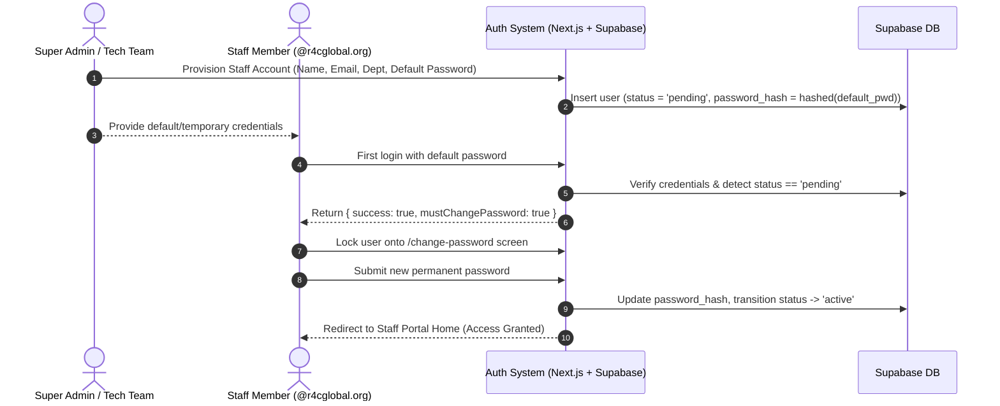
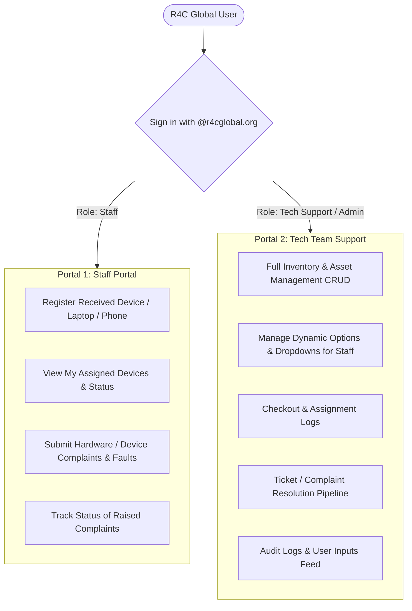

# Product Requirements Document (PRD)
# E310 Inventory & Device Management Platform

**Organization:** R4C Global  
**Managing Team:** E310 Tech Agency / Tech Support  
**Version:** 1.0 (Production Specification)  

---

## 1. Executive Summary & Vision

The E310 Inventory & Device Management Platform is being revamped from a single-tier inventory tracker into an enterprise-grade, **dual-portal hardware management and IT support platform**.

The system serves two distinct user groups within the R4C Global ecosystem:
1. **Portal 1: Staff Self-Service Portal (Company-Wide):** A clean, simple interface where any employee across R4C Global can register devices collected from IT, review equipment currently in their custody, and file device complaints or fault reports.
2. **Portal 2: Tech Team Support Command Center (Back-End / Admin):** A powerful command center for the E310 Tech Agency to monitor all incoming logs, manage asset inventory, dynamically configure form dropdowns/options for staff, receive instant multi-channel alerts, and delegate repair tickets.

---

## 2. Engineering & Collaboration Workflow (Git Policy)

Rebuilding takes place directly within this existing repository. To ensure stability and smooth teamwork across multiple contributors, the following rules are strictly enforced:

1. **Zero Direct Pushes to `main`:**
   * Direct commits to `main` are strictly prohibited.
   * `main` represents production-ready, deployable code only.
2. **Issue-Branch Pattern:**
   * Every contributor must create a dedicated feature branch for their assigned issue:
     * Format: `feature/issue-<number>-<short-description>` (e.g., `feature/issue-04-staff-device-registration`).
3. **Mandatory Implementation Plan:**
   * Before writing any code, the contributor assigned to an issue must write out an **Implementation Plan** (as a PR draft or issue comment) outlining:
     * Files to modify/create.
     * Database/API contracts impacted.
     * UI/UX states (loading, error, empty, success).
     * Test and verification checklist.
4. **Pull Request & Review Workflow:**
   * Changes are submitted via Pull Request targeting `main`.
   * PRs must link to their corresponding issue (`Closes #X`).
   * Only the repository lead / admin merges PRs into `main`.

---

## 3. Authentication, Domain Restriction & Staff Onboarding Flow

### 3.1 Organization Domain Enforcement
* **Target Domain:** `@r4cglobal.org`
* **Access Policy:**
  * Deprecate legacy `@theincubatorhub.org` and `@department.local` accounts.
  * System access is strictly restricted to verified `@r4cglobal.org` email addresses.

### 3.2 Role-Based Access Control (RBAC)
* **`Staff / Employee`:** Access to Portal 1 (Staff Self-Service Portal).
* **`Tech Support / Admin`:** Access to Portal 1 and Portal 2 (Back-End Operations).
* **`Super Admin`:** Full administrative control, user provisioning, audit logs, and system settings.

### 3.3 Admin-Provisioned Onboarding & First-Time Sign-In Flow



1. **Account Provisioning by Tech Support:**
   * In Portal 2, the Super Admin/Tech Support provisions staff accounts by entering:
     * Full Name, `@r4cglobal.org` Email, Department, and an auto-generated or custom **Default Temporary Password**.
   * The new account is saved in Supabase with `status: 'pending'`.
2. **First-Time Sign-In:**
   * Staff visits `/login` and enters their `@r4cglobal.org` email and the temporary default password.
   * The authentication route detects `status === 'pending'`.
3. **Mandatory Password Creation:**
   * The user is immediately locked into the **"Create Your Permanent Password"** screen (`/change-password`).
   * They cannot navigate to any portal pages until a valid permanent password is created.
4. **Account Activation:**
   * Once the permanent password is saved, the user's status transitions from `'pending'` to `'active'`.
   * The session is refreshed and routes them directly to their personalized Staff Portal.

---

## 4. Dual-Portal Architecture



---

## 5. Portal 1: Staff Self-Service Portal

### 5.1 Objectives
Provide an intuitive, frictionless interface where any employee across R4C Global can register their devices and raise issues without needing technical training.

### 5.2 Key Features
1. **Device Self-Registration:**
   * Staff can register a device collected from Tech Support (Laptop, Phone, Tablet, Peripheral).
   * Guided form with standardized dropdowns (configured dynamically by Tech Support).
   * Fields: Device type, brand/model, serial number/identifier, date collected, initial condition.
2. **"My Assigned Assets" Dashboard:**
   * At-a-glance view of all company equipment currently in the user's possession.
   * Clear status indicators (Active, Overdue for return, Under Repair).
3. **Complaint & Issue Reporting:**
   * Dedicated ticketing module for hardware or software problems with assigned devices.
   * Categorized issue types (Screen damage, battery issue, OS crash, physical wear, lost accessory, etc.).
   * Optional notes and upload of photo evidence.
   * Real-time ticket status tracking (`Submitted`, `Under Review`, `In Repair`, `Resolved`).
4. **Access Boundaries & Permissions:**
   * Staff permissions are strictly scoped to **Create & Read-Own**.
   * Staff cannot modify global device categories, delete inventory records, or edit records belonging to other staff members.

---

## 6. Portal 2: Tech Team Support & Administration

### 6.1 Objectives
Give the E310 Tech Agency total visibility, administrative authority, and workflow control over all organization assets and incoming staff requests.

### 6.2 Key Features
1. **Live Activity & Submissions Feed:**
   * Real-time feed of all staff registrations, complaints, and status changes.
2. **Dynamic Form & Option Manager:**
   * Tech team can add, rename, disable, or reorganize dropdown options that staff see in registration and complaint forms (e.g., new device models, complaint categories).
3. **Asset Inventory Management (Complete CRUD):**
   * Full control over Categories, Items, Serial Numbers, and Quantities.
   * Advanced filtering (by category, condition, status, assigned person, return date).
4. **Checkout & Custody Workflow:**
   * Check out, extend due dates, check in/return, and log return condition.
5. **Complaint Resolution & Super Admin Delegation Workflow:**
   * **Instant Multi-Channel Alert:** Whenever any staff member files a complaint, every member of the Tech Support team is notified immediately:
     * **In-Portal Notification:** Live alert bell badge in the Tech Support header with audio/visual indicator.
     * **Automated Email Alert:** Sent to all tech team members detailing the staff name, device model, severity, and description.
   * **Super Admin Task Delegation:**
     * The Super Admin can review the complaint queue and delegate/assign specific tickets to any admin/technician on the team directly from the portal.
   * **Technician Execution & Lifecycle Tracking:**
     * Assigned technician receives a direct assignment notification.
     * Technician logs diagnostic findings, orders parts if needed, and updates the ticket lifecycle (`Under Review` -> `In Repair` -> `Resolved`).
     * Staff member is automatically notified via email and in-portal status updates upon ticket resolution.

---

## 7. Back-End Architecture & Database Specifications

The backend is powered by Next.js Route Handlers (`src/app/api/`) and Supabase PostgreSQL.

### 7.1 Database Schema (PostgreSQL / Supabase)

#### 1. Table: `public.device_complaints` (Ticket Management)
* `id`: `uuid primary key default gen_random_uuid()`
* `ticket_number`: `text unique not null` (format: `TKT-YYYY-XXXX`)
* `user_id`: `uuid not null references public.department_users(id) on delete cascade`
* `item_id`: `uuid references public.items(id) on delete set null` (optional if self-reported)
* `device_summary`: `text not null` (e.g., "MacBook Pro 14 - C02FX1234ABC")
* `issue_type`: `text not null` (e.g., Screen, Battery, OS/Crash, Physical Damage, Lost/Stolen)
* `severity`: `text not null check (severity in ('low', 'medium', 'high', 'critical'))`
* `title`: `text not null`
* `description`: `text not null`
* `attachment_urls`: `text[] default '{}'` (screenshots or device photos)
* `status`: `text not null default 'submitted' check (status in ('submitted', 'under-review', 'in-repair', 'resolved', 'cancelled'))`
* `assigned_tech_id`: `uuid references public.department_users(id)`
* `resolution_notes`: `text`
* `resolved_at`: `timestamptz`
* `created_at`: `timestamptz not null default now()`
* `updated_at`: `timestamptz not null default now()`

#### 2. Table: `public.portal_options` (Dynamic Form & Dropdown Engine)
* `id`: `uuid primary key default gen_random_uuid()`
* `category_group`: `text not null` (e.g., `device_types`, `device_brands`, `issue_types`, `departments`)
* `label`: `text not null` (e.g., "HP EliteBook 840")
* `value`: `text not null` (e.g., "hp-elitebook-840")
* `is_active`: `boolean not null default true`
* `display_order`: `integer not null default 0`
* `created_at`: `timestamptz not null default now()`

#### 3. Table: `public.audit_logs` (Tech Team Live Activity Feed)
* `id`: `uuid primary key default gen_random_uuid()`
* `actor_id`: `uuid references public.department_users(id)`
* `actor_name`: `text not null`
* `action_type`: `text not null` (e.g., `device_registered`, `ticket_created`, `ticket_status_changed`, `option_added`)
* `entity_type`: `text not null` (`device`, `ticket`, `option`, `user`)
* `entity_id`: `text not null`
* `details`: `jsonb default '{}'::jsonb`
* `created_at`: `timestamptz not null default now()`

#### 4. Enhancements to `public.department_users`
* Add fields: `staff_id text`, `phone text`, `department text`.
* Enforce domain constraint on email: `check (email like '%@r4cglobal.org')`.

#### 5. Table: `public.notifications` (Multi-Channel Dispatch Engine)
* `id`: `uuid primary key default gen_random_uuid()`
* `recipient_id`: `uuid not null references public.department_users(id) on delete cascade`
* `title`: `text not null`
* `message`: `text not null`
* `notification_type`: `text not null check (notification_type in ('complaint_logged', 'complaint_assigned', 'complaint_status_changed', 'device_registered', 'system_alert'))`
* `link_url`: `text`
* `is_read`: `boolean not null default false`
* `email_sent`: `boolean not null default false`
* `created_at`: `timestamptz not null default now()`

---

### 7.2 Back-End API Endpoints (Next.js Route Handlers)

```
src/app/api/
├── auth/
│   ├── login/                     (POST: validates @r4cglobal.org, returns user & portal role)
│   ├── logout/                    (POST: clears session cookie)
│   └── me/                        (GET: returns authenticated profile & active role)
├── notifications/
│   ├── route.ts                   (GET: fetch unread user notifications)
│   └── [id]/read/route.ts         (PATCH: mark notification as read)
├── staff/
│   ├── devices/
│   │   ├── route.ts               (GET: list devices assigned to logged-in staff member)
│   │   └── register/route.ts      (POST: self-register a collected device)
│   ├── complaints/
│   │   ├── route.ts               (GET: list my tickets, POST: submit new ticket + trigger email/portal alerts)
│   │   └── [id]/route.ts          (GET: ticket details & conversation/updates)
│   └── options/route.ts           (GET: fetch active dropdown options for staff forms)
└── tech/
    ├── complaints/
    │   ├── route.ts               (GET: list/filter all organization tickets)
    │   ├── [id]/route.ts          (PATCH: update status, add resolution notes)
    │   └── [id]/assign/route.ts   (POST: Super Admin assigns ticket to specific admin/tech)
    ├── options/
    │   ├── route.ts               (GET: all option groups, POST: create new option)
    │   └── [id]/route.ts          (PATCH/DELETE: toggle active, rename, reorder)
    ├── activity/route.ts          (GET: live audit log feed of staff submissions)
    ├── devices/approve/route.ts   (POST: approve/confirm staff self-registered devices)
    ├── items/                     (Existing CRUD: items & inventory)
    ├── categories/                (Existing CRUD: categories)
    ├── checkouts/                 (Existing CRUD: checkouts & returns)
    └── users/                     (Existing CRUD: user management & role assignment)
```

---

## 8. UI/UX Design System & Brand Identity

### 8.1 Visual Direction & Philosophy
* **Inspiration Reference:** Modeled after the enterprise layout structure of `ethree10hr.com`, adapted for device inventory and technical support.
* **Strict Light Mode Mandate:**
  * **Canvas:** Pure white background (`#FFFFFF`) with subtle off-white layering (`#F8FAFC` / `#F1F5F9`) for secondary surfaces.
  * **Contrast & Borders:** Ultra-crisp, hairline borders (`#E2E8F0` / `#EDF2F7`) and micro-shadows (`box-shadow: 0 1px 2px 0 rgba(0, 0, 0, 0.04)`).
  * **Strictly NO dark mode:** Clean, executive light mode only.
  * **Anti-AI Aesthetic:** Must feel bespoke, grounded, and human-crafted—no generic gradients, overused purple/indigo blobs, or cookie-cutter templates.

### 8.2 Brand Identity & Logo
* **Logo:** Stylized geometric **`E310`** wordmark (as displayed in the top-left of the reference).
  * High-density vector SVG representation with custom tech typography.
* **Role Context Badge:** Directly below the logo in the sidebar:
  * `Working as Staff` (in Portal 1)
  * `Working as Tech Support` (in Portal 2)
* **Typography:** Modern, premium geometric sans-serif (`Plus Jakarta Sans` or `Inter`) with clean optical sizing, legible numbers, and tight headings.

### 8.3 Color Palette & Design Tokens (Light Mode)

| Token Name | Hex Code | Purpose & Usage |
| :--- | :--- | :--- |
| `--bg-canvas` | `#FFFFFF` | Pure white main viewport and card backgrounds |
| `--bg-surface-subtle` | `#F8FAFC` | Sidebar background, secondary container panels |
| `--border-subtle` | `#E2E8F0` | Structural card borders and divider lines |
| `--text-primary` | `#0F172A` | Primary headings, body copy, high-contrast labels |
| `--text-secondary` | `#64748B` | Subtext, timestamps, field descriptions |
| `--accent-lime` | `#D4F868` | Active navigation pill, high-priority status badge |
| `--accent-teal` | `#0D9488` | IT status badges, icons, verification indicators |
| `--status-active` | `#16A34A` | Healthy devices, resolved tickets |
| `--status-warning` | `#EA580C` | Due soon, low stock, pending review |
| `--status-danger` | `#DC2626` | Damaged device, overdue return, critical complaint |

### 8.4 Key UI Components
1. **Collapsible Multi-Level Sidebar:**
   * Logo header with collapsible trigger (`⌘[` or toggle icon).
   * Grouped sections:
     * *Staff View:* `Home`, `My Devices`, `Report Issue / Complaint`, `IT Bulletins`.
     * *Tech Team View:* `Dashboard`, `Inventory Catalog`, `Checkouts & Assignments`, `Support Tickets`, `Form Options Manager`, `User Directory`.
   * High-contrast active tab with lime/neon pill badge (`#D4F868`) and dark text.
   * User profile card at the bottom with avatar, full name, role badge, and quick log-out.
2. **Top Application Bar:**
   * Global command search (`Search devices, tickets, staff... ⌘K`).
   * Quick status toggles, notifications bell, and quick help.
3. **Hero Greeting Section:**
   * Clean headline: `Welcome back, [First Name] 👋`
   * Dynamic contextual subtitle: `Here's an overview of your assigned equipment and active requests.` + live date (e.g. `Thursday, October 15, 2026`).
4. **Quick Asset & Policy Cards:**
   * Modular horizontal card grid for quick access:
     * *My Primary Device* (Model, serial number, status pill).
     * *Report a Fault / Repair Request* (Quick trigger modal).
     * *Equipment Care Policy* (Guidelines & rules).
5. **IT Announcements & CEO/Leadership Bulletin Card:**
   * Dedicated right-hand card for IT alerts (e.g., Scheduled maintenance, device return dates, OS update announcements).

---

## 9. Mobile Responsiveness & Progressive Web App (PWA)

### 9.1 Mobile Responsiveness (Non-Negotiable Requirement)
* **Design Priority:** Every single page, modal, and component must be 100% responsive across mobile (< 640px), tablet (640px - 1024px), and desktop (> 1024px).
* **Navigation Adaptability:**
  * Desktop: Collapsible multi-tier sidebar.
  * Mobile: Bottom navigation bar for primary staff actions (`Home`, `My Devices`, `Report Issue`, `Profile`) + slide-out sheet drawer for secondary links.
* **Touch-Friendly Controls:**
  * Minimum 44x44px touch targets for buttons, selectors, and form elements.
  * Card-based stacked layouts on mobile instead of horizontal tables with awkward scrolling.

### 9.2 PWA (Installable Application)
* **Installability:**
  * Full Web App Manifest (`manifest.json`) with high-resolution icons (192px, 512px, maskable), standalone display mode, and clean splash screen.
  * In-app install banner/prompt for staff on iOS (Safari Add to Home Screen guide) and Android (Native install trigger).
* **Offline Readiness & Service Worker:**
  * Cache core app shell, fonts, and assets for instant load speeds even under poor connectivity.
  * Graceful offline state indicator when connectivity drops.

---

## 10. Code Quality, Architecture & Standards

To ensure the codebase remains maintainable, scalable, and easy for the entire team to contribute to without regression, all contributors must strictly adhere to these standards:

1. **Strict TypeScript & Type Safety:**
   * No implicit `any`. All database models, API payloads, form states, and props must be strictly typed under `src/types/`.
2. **Modular Directory Architecture:**
   * Separation of Concerns:
     * `src/app/` — Route handlers and page layouts only.
     * `src/components/` — UI components broken down into atomic domain folders (`staff/`, `tech/`, `common/`, `layout/`).
     * `src/lib/` — Business logic, database clients, authentication, and utilities.
3. **Anti-Haphazard Coding:**
   * No bloated, 500+ line monolithic components.
   * Reusable UI primitives (Buttons, Modals, Inputs, Cards, Badges) must live in `src/components/common/`.
4. **Self-Documenting Code & Comments:**
   * Meaningful variable/function names.
   * JSDoc comments explaining the intent and assumptions behind business logic.
